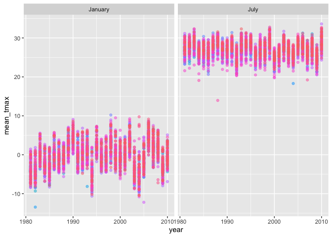
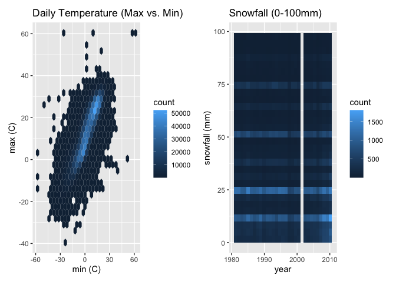
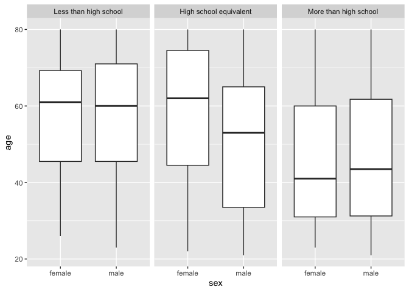
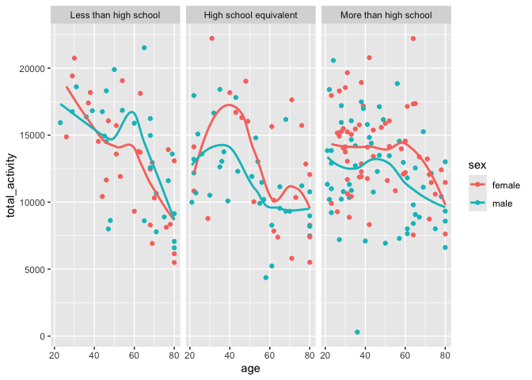
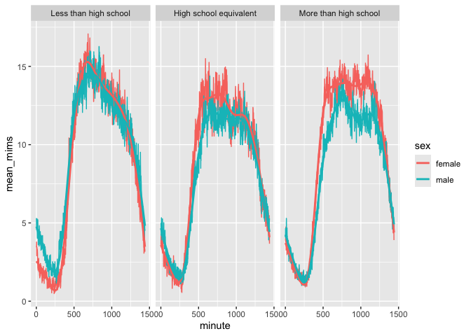
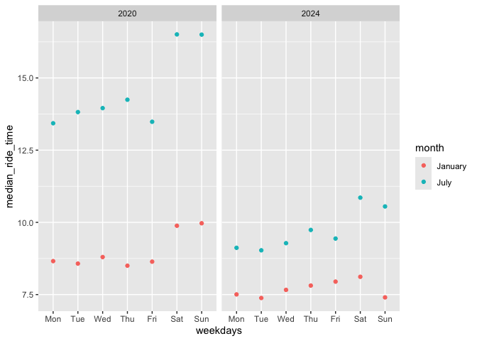
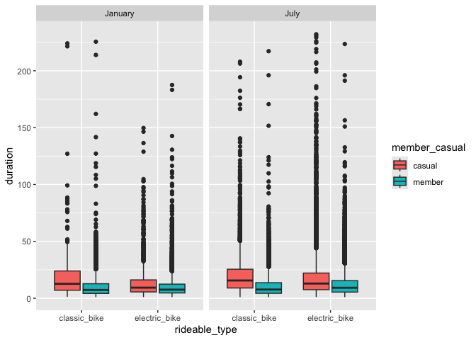

p8105_hw3_mjd2283
================
Max
2026-10-18

``` r
library(p8105.datasets)
library(tidyverse)
```

    ## ── Attaching core tidyverse packages ──────────────────────── tidyverse 2.0.0 ──
    ## ✔ dplyr     1.2.1     ✔ readr     2.2.0
    ## ✔ forcats   1.0.1     ✔ stringr   1.6.0
    ## ✔ ggplot2   4.0.3     ✔ tibble    3.3.1
    ## ✔ lubridate 1.9.5     ✔ tidyr     1.3.2
    ## ✔ purrr     1.2.2     
    ## ── Conflicts ────────────────────────────────────────── tidyverse_conflicts() ──
    ## ✖ dplyr::filter() masks stats::filter()
    ## ✖ dplyr::lag()    masks stats::lag()
    ## ℹ Use the conflicted package (<http://conflicted.r-lib.org/>) to force all conflicts to become errors

``` r
data("ny_noaa")

ny_noaa
```

    ## # A tibble: 2,595,176 × 7
    ##    id          date        prcp  snow  snwd tmax  tmin 
    ##    <chr>       <date>     <int> <int> <int> <chr> <chr>
    ##  1 US1NYAB0001 2007-11-01    NA    NA    NA <NA>  <NA> 
    ##  2 US1NYAB0001 2007-11-02    NA    NA    NA <NA>  <NA> 
    ##  3 US1NYAB0001 2007-11-03    NA    NA    NA <NA>  <NA> 
    ##  4 US1NYAB0001 2007-11-04    NA    NA    NA <NA>  <NA> 
    ##  5 US1NYAB0001 2007-11-05    NA    NA    NA <NA>  <NA> 
    ##  6 US1NYAB0001 2007-11-06    NA    NA    NA <NA>  <NA> 
    ##  7 US1NYAB0001 2007-11-07    NA    NA    NA <NA>  <NA> 
    ##  8 US1NYAB0001 2007-11-08    NA    NA    NA <NA>  <NA> 
    ##  9 US1NYAB0001 2007-11-09    NA    NA    NA <NA>  <NA> 
    ## 10 US1NYAB0001 2007-11-10    NA    NA    NA <NA>  <NA> 
    ## # ℹ 2,595,166 more rows

``` r
ny_noaa_df = ny_noaa |>
  janitor::clean_names() |>
  separate(date, into = c("year", "month", "day"), sep = "-") |>
  mutate(
    tmax = as.numeric(tmax) / 10,
    tmin = as.numeric(tmin) / 10,
    prcp = prcp / 10, 
    year = as.numeric(year),
    month = as.numeric(month),
    day = as.numeric(day))
  
#used AI for finding out how to separate; specifically sep = "-"
  
ny_noaa_df
```

    ## # A tibble: 2,595,176 × 9
    ##    id           year month   day  prcp  snow  snwd  tmax  tmin
    ##    <chr>       <dbl> <dbl> <dbl> <dbl> <int> <int> <dbl> <dbl>
    ##  1 US1NYAB0001  2007    11     1    NA    NA    NA    NA    NA
    ##  2 US1NYAB0001  2007    11     2    NA    NA    NA    NA    NA
    ##  3 US1NYAB0001  2007    11     3    NA    NA    NA    NA    NA
    ##  4 US1NYAB0001  2007    11     4    NA    NA    NA    NA    NA
    ##  5 US1NYAB0001  2007    11     5    NA    NA    NA    NA    NA
    ##  6 US1NYAB0001  2007    11     6    NA    NA    NA    NA    NA
    ##  7 US1NYAB0001  2007    11     7    NA    NA    NA    NA    NA
    ##  8 US1NYAB0001  2007    11     8    NA    NA    NA    NA    NA
    ##  9 US1NYAB0001  2007    11     9    NA    NA    NA    NA    NA
    ## 10 US1NYAB0001  2007    11    10    NA    NA    NA    NA    NA
    ## # ℹ 2,595,166 more rows

The original dataset is a tibble that is 7 columns and 2,595,176 rows.
The data is divided by ID number which appears to be the same for each
row. Other key variables are `date`, `pcrp`, `snow`, `snwd`, `tmax`, and
`tmin`.

``` r
ny_noaa_df |> 
  count(snow, name = "n_obs") |>
  arrange(desc(n_obs)) |>
  filter(min_rank(desc(n_obs)) < 11) |>
  knitr::kable()
```

| snow |   n_obs |
|-----:|--------:|
|    0 | 2008508 |
|   NA |  381221 |
|   25 |   31022 |
|   13 |   23095 |
|   51 |   18274 |
|   76 |   10173 |
|    8 |    9962 |
|    5 |    9748 |
|   38 |    9197 |
|    3 |    8790 |

``` r
#Used arrange to order from most common to least
#Filter helps make the list smaller
```

Some of the most commonly observed values for snowfall include 0 mm, NA,
25 mm, 13 mm,and 51 mm. 0mm being first makes sense since it doesn’t
snow in New York at lot over the course of the year.

\#Looking at average max temperature now

``` r
ny_noaa_df |>
  filter(month %in% c(1,7)) |>
  mutate(month = case_when(
    month == 1 ~ "January",
    month == 7 ~ "July")) |>
  group_by(id, year, month) |>
  summarize(mean_tmax = mean(tmax, na.rm = TRUE)) |>
  ggplot(aes(x = year, y=mean_tmax, color = id)) +
  geom_point(alpha = .5) +
  facet_grid(. ~ month) +
  theme(legend.position = "none")
```

    ## `summarise()` has regrouped the output.
    ## ℹ Summaries were computed grouped by id, year, and month.
    ## ℹ Output is grouped by id and year.
    ## ℹ Use `summarise(.groups = "drop_last")` to silence this message.
    ## ℹ Use `summarise(.by = c(id, year, month))` for per-operation grouping
    ##   (`?dplyr::dplyr_by`) instead.

    ## Warning: Removed 5970 rows containing missing values or values outside the scale range
    ## (`geom_point()`).

<!-- -->

``` r
#Used AI assistance to mutate using case_when to switch numbers to month terms. Also used AI assistance to get rid of the legend by using theme(legend.position = "none")
```

The mean temperature in January is much lower compared to the mean
temperature in July. This result is expected. The temperature fluctuates
more in January in a zig zap (up and down) appearance over the years.
The temperature in July appears to have less variation. There are some
outliers in the graphs. For instance, one outlier shows a very cold July
year around 1988.

``` r
tmax_tmin =
  ny_noaa_df |> 
  ggplot(aes(x = tmin, y = tmax)) +
  geom_hex() +
  labs(
    title = "Daily Temperature (Max vs. Min)",
    x = "min (C)",
    y = "max (C)"
    )

#using geom_hex() here since lots of data

snow_dist =
  ny_noaa_df |> 
  filter(snow > 0, snow < 100) |>
  ggplot(aes(x = year, y = snow)) +
  geom_bin2d() +
  labs( 
    title = "Snowfall (0-100mm)",
    x = "year",
    y = "snowfall (mm)"
  )
  
#used geom_bin2d()

library(patchwork)

tmax_tmin + snow_dist
```

    ## Warning: Removed 1136276 rows containing non-finite outside the scale range
    ## (`stat_binhex()`).

    ## `stat_bin2d()` using `bins = 30`. Pick better value `binwidth`.

<!-- -->
\#Problem 2 on Accelerometers (wearable sensors)

``` r
nhanes_covar_df = 
  read_csv(file = "./nhanes_covar.csv", skip = 4, na = c("NA", ".", "")) |>
  janitor::clean_names() |>
  filter(age >= 21) |>
  drop_na() |>
  mutate(
    sex = case_when(
      sex == 1 ~ "male",
      sex == 2 ~ "female"),
    sex = factor(sex), 
    education = case_when(
      education == 1 ~ "Less than high school",
      education == 2 ~ "High school equivalent",
      education == 3 ~ "More than high school"),
    education = forcats::fct_relevel(
      education, c("Less than high school", "High school equivalent", "More than high school")))
```

    ## Rows: 250 Columns: 5
    ## ── Column specification ────────────────────────────────────────────────────────
    ## Delimiter: ","
    ## dbl (5): SEQN, sex, age, BMI, education
    ## 
    ## ℹ Use `spec()` to retrieve the full column specification for this data.
    ## ℹ Specify the column types or set `show_col_types = FALSE` to quiet this message.

``` r
#using case_when again here, got from AI assistance but also in the notes
#factor() to convert to categorical
#used AI assistance here to help identify which variables need to be reclassified and strategize how to approach

#using forcats:fct_relevel() since working with factors, and reordered it into those 3 groups

nhanes_covar_df
```

    ## # A tibble: 228 × 5
    ##     seqn sex      age   bmi education             
    ##    <dbl> <fct>  <dbl> <dbl> <fct>                 
    ##  1 62161 male      22  23.3 High school equivalent
    ##  2 62164 female    44  23.2 More than high school 
    ##  3 62169 male      21  20.1 High school equivalent
    ##  4 62174 male      80  33.9 More than high school 
    ##  5 62177 male      51  20.1 High school equivalent
    ##  6 62178 male      80  28.5 High school equivalent
    ##  7 62180 male      35  27.9 More than high school 
    ##  8 62184 male      26  22.1 High school equivalent
    ##  9 62189 female    30  22.4 More than high school 
    ## 10 62199 male      57  28   More than high school 
    ## # ℹ 218 more rows

``` r
#has some extra info at top originally so need to skip that

nhanes_accel_df =
    read_csv(file = "./nhanes_accel.csv") |>
    janitor::clean_names() |>
    pivot_longer(
      starts_with("min"),
      names_to = "minute",
      names_prefix = "min",
      values_to = "mims") |>
    mutate(minute = as.numeric(minute))
```

    ## Rows: 250 Columns: 1441
    ## ── Column specification ────────────────────────────────────────────────────────
    ## Delimiter: ","
    ## dbl (1441): SEQN, min1, min2, min3, min4, min5, min6, min7, min8, min9, min1...
    ## 
    ## ℹ Use `spec()` to retrieve the full column specification for this data.
    ## ℹ Specify the column types or set `show_col_types = FALSE` to quiet this message.

``` r
#whenever really long data going across with same variable, you want to pivot longer

nhanes_accel_df
```

    ## # A tibble: 360,000 × 3
    ##     seqn minute  mims
    ##    <dbl>  <dbl> <dbl>
    ##  1 62161      1 1.11 
    ##  2 62161      2 3.12 
    ##  3 62161      3 1.47 
    ##  4 62161      4 0.938
    ##  5 62161      5 1.60 
    ##  6 62161      6 0.145
    ##  7 62161      7 2.10 
    ##  8 62161      8 0.509
    ##  9 62161      9 1.63 
    ## 10 62161     10 1.20 
    ## # ℹ 359,990 more rows

``` r
nhanes_df = left_join(nhanes_covar_df, nhanes_accel_df, by = "seqn")

nhanes_covar_df |>
  count(education, sex) |>
  pivot_wider(
    names_from = sex,
    values_from = n) |>
  knitr::kable()
```

| education              | female | male |
|:-----------------------|-------:|-----:|
| Less than high school  |     28 |   27 |
| High school equivalent |     23 |   35 |
| More than high school  |     59 |   56 |

In the less than high school category, there is 28 females and 27 males.
In the high school equivalent category, there is 23 females and 35
males. In the more than high school category, there is 59 females and 56
males.

``` r
nhanes_covar_df |> 
  ggplot(aes(x = sex, y= age)) + 
  geom_boxplot() +
  facet_grid(. ~ education)
```

<!-- -->

``` r
#used facet_grid to clearly separate education
```

``` r
total_activity_df =
  nhanes_df |>
  group_by(seqn, age, sex, education) |>
  summarize(total_activity = sum(mims))
```

    ## `summarise()` has regrouped the output.
    ## ℹ Summaries were computed grouped by seqn, age, sex, and education.
    ## ℹ Output is grouped by seqn, age, and sex.
    ## ℹ Use `summarise(.groups = "drop_last")` to silence this message.
    ## ℹ Use `summarise(.by = c(seqn, age, sex, education))` for per-operation
    ##   grouping (`?dplyr::dplyr_by`) instead.

``` r
#grouped by the categories needed for analysis

total_activity_df |> 
  ggplot(aes(x = age, y = total_activity, color = sex)) +
  geom_point() +
  facet_grid(.~education) +
  geom_smooth(se = FALSE)
```

    ## `geom_smooth()` using method = 'loess' and formula = 'y ~ x'

<!-- -->

The plot above shows how age varies with total activity across education
levels. The smooth lines show a general decrease with total activity
over age for both genders. For the high school equivalent group and more
than high school group, females tended to exercise more than males.
While in the less than high school group, the lines crossed, but with
age, males tend to exercise more than females.

``` r
nhanes_df |>
  group_by(education, sex, minute) |>
  summarize(mean_mims = mean(mims)) |>
  ggplot(aes(x = minute, y = mean_mims, color = sex)) +
  geom_line() +
  facet_grid(. ~ education) +
  geom_smooth(se = FALSE)
```

    ## `summarise()` has regrouped the output.
    ## `geom_smooth()` using method = 'gam' and formula = 'y ~ s(x, bs = "cs")'
    ## ℹ Summaries were computed grouped by education, sex, and minute.
    ## ℹ Output is grouped by education and sex.
    ## ℹ Use `summarise(.groups = "drop_last")` to silence this message.
    ## ℹ Use `summarise(.by = c(education, sex, minute))` for per-operation grouping
    ##   (`?dplyr::dplyr_by`) instead.

<!-- -->
There is a peak during the middle of each graph which makes sense since
that would be during the day when the individual is most active. So
there mean_mims would increase since that is the accelerometer value.

\#Problem 3

``` r
jan_2020 = read_csv("./citibike/Jan 2020 Citi.csv") |>
  mutate(year = 2020, month = "January")
```

    ## Rows: 12420 Columns: 7
    ## ── Column specification ────────────────────────────────────────────────────────
    ## Delimiter: ","
    ## chr (6): ride_id, rideable_type, weekdays, start_station_name, end_station_n...
    ## dbl (1): duration
    ## 
    ## ℹ Use `spec()` to retrieve the full column specification for this data.
    ## ℹ Specify the column types or set `show_col_types = FALSE` to quiet this message.

``` r
july_2020 = read_csv("./citibike/July 2020 Citi.csv") |>
  mutate(year = 2020, month = "July")
```

    ## Rows: 21048 Columns: 7
    ## ── Column specification ────────────────────────────────────────────────────────
    ## Delimiter: ","
    ## chr (6): ride_id, rideable_type, weekdays, start_station_name, end_station_n...
    ## dbl (1): duration
    ## 
    ## ℹ Use `spec()` to retrieve the full column specification for this data.
    ## ℹ Specify the column types or set `show_col_types = FALSE` to quiet this message.

``` r
jan_2024 = read_csv("./citibike/Jan 2024 Citi.csv") |>
  mutate(year = 2024, month = "January")
```

    ## Rows: 18861 Columns: 7
    ## ── Column specification ────────────────────────────────────────────────────────
    ## Delimiter: ","
    ## chr (6): ride_id, rideable_type, weekdays, start_station_name, end_station_n...
    ## dbl (1): duration
    ## 
    ## ℹ Use `spec()` to retrieve the full column specification for this data.
    ## ℹ Specify the column types or set `show_col_types = FALSE` to quiet this message.

``` r
july_2024 = read_csv("./citibike/July 2024 Citi.csv") |>
  mutate(year = 2024, month = "July")
```

    ## Rows: 47156 Columns: 7
    ## ── Column specification ────────────────────────────────────────────────────────
    ## Delimiter: ","
    ## chr (6): ride_id, rideable_type, weekdays, start_station_name, end_station_n...
    ## dbl (1): duration
    ## 
    ## ℹ Use `spec()` to retrieve the full column specification for this data.
    ## ℹ Specify the column types or set `show_col_types = FALSE` to quiet this message.

``` r
#need to read multiple csv files
#used AI assistance to help upload, mutated each csv to include the year and month so that I can join them 

citi_bike_df =
  bind_rows(jan_2020, july_2020, jan_2024, july_2024) |>
  janitor::clean_names() |>
  mutate(weekdays = forcats::fct_relevel(weekdays, c("Monday", "Tuesday", "Wednesday", "Thursday", "Friday", "Saturday", "Sunday"))) |>
  select(year, month, everything())
  
citi_bike_df
```

    ## # A tibble: 99,485 × 9
    ##     year month   ride_id      rideable_type weekdays duration start_station_name
    ##    <dbl> <chr>   <chr>        <chr>         <fct>       <dbl> <chr>             
    ##  1  2020 January 4BE06CB33B0… classic_bike  Tuesday     15.3  Columbus Ave & W …
    ##  2  2020 January 26886E03497… classic_bike  Wednesd…     5.31 2 Ave & E 96 St   
    ##  3  2020 January 24DC56060EB… classic_bike  Friday       9.69 Columbia St & Riv…
    ##  4  2020 January EEDC1053582… classic_bike  Sunday       7.00 W 84 St & Columbu…
    ##  5  2020 January 2CD4BD4CEE2… classic_bike  Friday       2.85 Forsyth St & Broo…
    ##  6  2020 January E18682F9A4E… classic_bike  Sunday      25.5  Allen St & Hester…
    ##  7  2020 January B9B2E8960A7… classic_bike  Sunday       3.65 Lafayette St & Je…
    ##  8  2020 January DEF8F50495E… classic_bike  Sunday      38.3  28 Ave & 44 St    
    ##  9  2020 January 17D44DA993F… classic_bike  Thursday    38.5  Barrow St & Hudso…
    ## 10  2020 January 0FD113A3093… classic_bike  Tuesday      6.52 Carlton Ave & Par…
    ## # ℹ 99,475 more rows
    ## # ℹ 2 more variables: end_station_name <chr>, member_casual <chr>

``` r
#Used forcats::fct_relevel to make sure the days of the week are in the right order for my plotting. This tool is nice. Could of also ordered Jan and July but don't have to 
```

The new dataset called `citi_bike_df` has 99485 rides and 9 different
variables: `year`, `month`, `ride_id`, `rideable_type`, `weekdays`,
`duration`, `start_station_name`, `end_station_name`, and
`member_casual`.

``` r
citi_bike_df |>
  count(year, month, member_casual) |>
  pivot_wider(
    names_from = member_casual,
    values_from = n) |>
  knitr::kable()
```

| year | month   | casual | member |
|-----:|:--------|-------:|-------:|
| 2020 | January |    984 |  11436 |
| 2020 | July    |   5637 |  15411 |
| 2024 | January |   2108 |  16753 |
| 2024 | July    |  10894 |  36262 |

``` r
#total number of rides in each combination of year and month separating casual riders and members
```

The above table shows the total number of riders in each year and month
combination. Members out number the casual riders in every instance. In
addition, user size has increased in both casual and member categories.

``` r
citi_bike_df |>
  filter(year == 2024, month == "July") |>
  count(start_station_name) |>
  filter(min_rank(desc(n)) < 6) |>
  arrange(desc(n)) |>
  knitr::kable()
```

| start_station_name       |   n |
|:-------------------------|----:|
| Pier 61 at Chelsea Piers | 163 |
| University Pl & E 14 St  | 155 |
| W 21 St & 6 Ave          | 152 |
| West St & Chambers St    | 150 |
| W 31 St & 7 Ave          | 146 |

``` r
#cant use original Jul 2026 since didn't clean data
```

The table above shows the top 5 most popular starting stations for July
2024, and the n amount of rides from that station in the month.

``` r
citi_bike_df |>
  group_by(year, month, weekdays) |>
  summarize(median_ride_time = median(duration)) |>
  ggplot(aes(x = weekdays, y = median_ride_time, color = month)) + 
  geom_point() +
  facet_grid(. ~ year) +
  scale_x_discrete(labels =c("Mon", "Tue", "Wed", "Thu", "Fri", "Sat", "Sun"))
```

    ## `summarise()` has regrouped the output.
    ## ℹ Summaries were computed grouped by year, month, and weekdays.
    ## ℹ Output is grouped by year and month.
    ## ℹ Use `summarise(.groups = "drop_last")` to silence this message.
    ## ℹ Use `summarise(.by = c(year, month, weekdays))` for per-operation grouping
    ##   (`?dplyr::dplyr_by`) instead.

<!-- -->

``` r
#day labels were too long, used AI assistance to change labels to shorter versions. used scale_x_discrete
```

The plot above shows weekdays in January and July, 2020 on the left and
2024 on the right. The median ride time is longer in July compared to
January. In 2020, the difference in median ride time between the month
categories was a lot greater than compared to the smaller difference
seen in 2024. Median ride time was overall shorter in 2024 compared to
2020.

``` r
citi_bike_df |>
  filter(year == 2024) |>
  ggplot(aes(x = rideable_type, y = duration, fill = member_casual)) +
  geom_boxplot() +
  facet_grid(. ~ month)
```

<!-- --> I
chose a box plot to show to show the duration of rides comparing bike
type and member casual type across each month. Casual bikers tended to
have a larger duration in bike ride compared to member bikers. Also,
member bikers on average had a more even usage of classic and electric
bikes, while casual bikers used classic bikes more.
